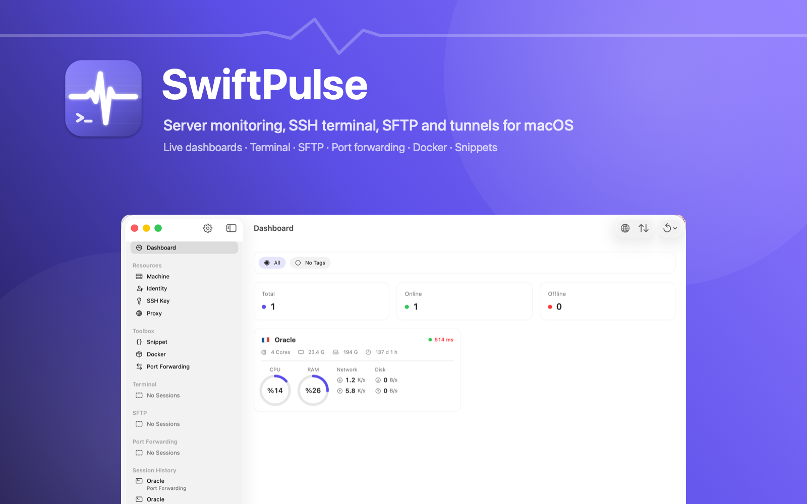
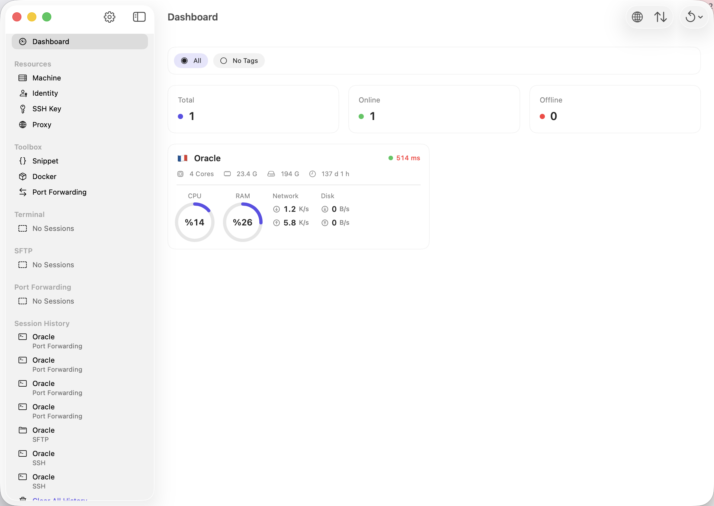
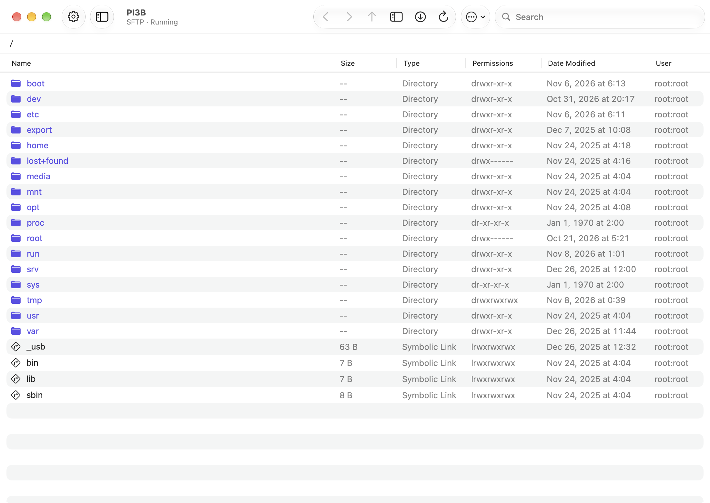

# SwiftPulse

[](https://github.com/sineld/SwiftPulse/actions/workflows/test.yml)
[](https://github.com/sineld/SwiftPulse/releases/latest)


[](LICENSE)
[](https://github.com/sponsors/sineld)



SwiftPulse is a native macOS app for working with your servers over SSH. It shows live metrics for every machine on a dashboard, and has an SSH terminal, an SFTP file browser, port forwarding, a Docker panel and reusable snippets. It also includes an MCP server, so AI agents such as Claude Code can work on your machines, with your approval for every change.

It is built with SwiftUI and SwiftData on top of [Citadel](https://github.com/orlandos-nl/Citadel) (SSH and SFTP) and [SwiftTerm](https://github.com/migueldeicaza/SwiftTerm) (terminal). SwiftPulse is free and open source under the MIT License. If it's useful to you, please consider [sponsoring its development](https://github.com/sponsors/sineld).

## Contents

- [Download](#download)
- [Screenshots](#screenshots)
- [Features](#features)
  - [Machines, groups and tags](#machines-groups-and-tags)
  - [Identities, SSH keys and proxies](#identities-ssh-keys-and-proxies)
  - [Connections and host keys](#connections-and-host-keys)
  - [Dashboard and monitoring](#dashboard-and-monitoring)
  - [Terminal](#terminal)
  - [SFTP](#sftp)
  - [Port forwarding](#port-forwarding)
  - [Snippets](#snippets)
  - [Docker](#docker)
  - [Session history](#session-history)
  - [MCP server for AI agents](#mcp-server-for-ai-agents)
  - [Sync between Macs](#sync-between-macs)
  - [Settings](#settings)
- [Security and privacy](#security-and-privacy)
- [Where your data lives](#where-your-data-lives)
- [Not supported yet](#not-supported-yet)
- [Build from source](#build-from-source)
- [Contributing](#contributing)
- [Support](#support)
- [License](#license)

## Download

1. Download `SwiftPulse-<version>.dmg` from the [latest release](https://github.com/sineld/SwiftPulse/releases/latest). It is a universal app for Apple silicon and Intel Macs.
2. Open the DMG and drag SwiftPulse onto the Applications folder.
3. The app is signed with a Developer ID and notarized by Apple, so it opens without any warning.

**Requirements:** macOS 15 Sequoia or later. On the server side you need an SSH server. Live metrics work on Linux and macOS hosts.

## Screenshots

| Dashboard | SFTP |
|---|---|
|  |  |

## Features

### Machines, groups and tags

- **Add a machine** with a name, host, port (default 22), sign-in method, group, tags, a default SFTP folder and a remark. **Test Connection** signs in for real and shows the server's `uname` and hostname before you save.
- **Sign-in methods:** an identity, a password or key, or none at all, for servers that need no credentials such as Tailscale SSH.
- **Jump hosts:** chain up to five hops in order. Chains that loop are rejected.
- **Connection proxy:** go through a saved SOCKS5 or HTTP CONNECT proxy, or a `ProxyCommand` with `%h`, `%p`, `%r` and `%%` placeholders. A ProxyCommand takes precedence over a proxy.
- **Groups:** start terminals or SFTP sessions for every machine in a group at once. Deleting a group keeps its machines.
- **Tags:** filter every list by tag, by "No Tags" or by "All".
- **Views:** grid or list, sorted by name or date. You can hide host addresses, for example while sharing your screen. Search matches names, hosts and tags.
- **Search everywhere:** press <kbd>⌘</kbd><kbd>F</kbd> on any page or sheet with a search field (machines, identities, keys, proxies, snippets, Docker, port forwarding, the dashboard, SFTP and the process list) to jump straight to it.
- **Actions:** double-click a machine to open a terminal. Its context menu has Start Terminal, Start SFTP, Edit, Duplicate and Delete.
- **Per-machine switches:** "Show Status in Dashboard" and "Hide from AI Agents".

#### Import from `~/.ssh/config`

**Import from SSH Config…** lists every concrete `Host` in your SSH config, following `Include` lines up to eight levels deep. Each host is resolved with `ssh -G`, so `Match` blocks and defaults apply. For each host it imports the HostName, Port, User, the first IdentityFile that exists and the ProxyJump chain:

- Key files are copied into SwiftPulse once and reused when several hosts share the same key.
- Keys with a passphrase are flagged, so you know to enter the passphrase in SSH Keys.
- Jump hosts are linked to machines in the same import or already in SwiftPulse.
- Hosts you already have are shown as "Already added". `git` hosts are listed but not selected.
- The result screen lists what was added, what was already there and anything to check.

### Identities, SSH keys and proxies

- **Identities:** a reusable username with a password, an SSH key or both. When both are set, the key is tried first.
- **SSH keys:**
  - **Generate:** Ed25519 and ECDSA P-256, P-384 and P-521 keys.
  - **Import:** paste a key or pick a file. The picker opens in `~/.ssh`, shows hidden files and finds the matching `.pub` file. Accepted formats are OpenSSH private keys (Ed25519, ECDSA and RSA) and PKCS#1 RSA PEM keys, which are converted on import. RSA keys sign in with `rsa-sha2-256`, because OpenSSH servers reject SHA-1.
  - **Key details:** the SHA256 fingerprint, Copy Public Key and Show Private Key. Showing the private key can require Touch ID; see [Security and privacy](#security-and-privacy).
  - **Export Public Key to Server:** appends the key to `~/.ssh/authorized_keys` on any machine. It never adds a duplicate and sets the permissions to 700 for the folder and 600 for the file.
- **Proxies:** SOCKS5 or HTTP CONNECT, optionally with a username and password. Delete a proxy and the machines that used it connect directly.

### Connections and host keys

- **Connection timeout:** 15 seconds by default, adjustable from 5 to 120.
- **Sign-in order:** SwiftPulse only tries the methods the server offers, key first, then password.
- **Host keys are checked on every connection:**
  - **Unknown host:** SwiftPulse shows its SHA256 fingerprint and asks whether to trust it.
  - **Changed key:** SwiftPulse shows a critical warning with both fingerprints.
  - **Automatic trust:** "Trust New Host Keys Automatically" only applies to hosts seen for the first time. A changed key always asks.
  - **Managing keys:** saved keys are listed in Settings › Known Hosts, where you can forget them.

### Dashboard and monitoring

- **Dashboard:** counters for total, online and offline machines, and a card for each machine with:
  - its country flag and latency (green under 100 ms, orange under 300 ms, red above),
  - cores, memory, disk, uptime and temperature,
  - CPU and memory gauges, network and disk throughput.
- **Toolbar:** a **Global View** map shows every machine with its flag and latency, and **Refresh All** / **Refresh Failed Only** poll again on demand.
- **Status page:** click a card to open it. It shows:
  - per-core CPU usage with user, system, nice, iowait and steal,
  - a 1, 5 and 15 minute load chart,
  - memory with cache and swap, and the top 15 processes,
  - per-interface network rates and totals, established TCP connections and retransmits,
  - every mount with a usage bar, and per-disk reads, writes, IOPS and wait time,
  - the machine's IP location on a map (this can be hidden).
  - a Docker summary: engine version, running containers, images, total CPU and memory, and the containers using the most memory. Click it to open the machine's Docker page.
- **All Processes:** the 100 busiest processes with their full command lines, refreshed every 3 seconds. You can sort and search them, copy a PID or command, and **Terminate** or **Force Kill** a process after a confirmation. If the SSH user may not signal the process, SwiftPulse falls back to `sudo -n`.
- **How metrics are collected:**
  - Each poll is one SSH command. Nothing is installed on the server.
  - **Linux** metrics come from `/proc`, `/sys`, `df`, `ip` and `ps`. **macOS** hosts use `sysctl`, `vm_stat`, `top`, `netstat` and `df`.
  - Temperature, disk I/O and TCP figures are Linux only.
  - Virtual interfaces and pseudo file systems are left out, including Docker, veth, bridges, WireGuard, Tailscale and ZeroTier.
- **Polling:**
  - Interval: every 5 seconds by default, adjustable from 2 to 60.
  - Polling pauses while no SwiftPulse window is visible.
  - A dropped connection is retried quickly, then with a growing delay up to 30 seconds. A machine is shown as offline only after two failures in a row.
- **Menu bar monitor:** shows each dashboard machine with a status dot, CPU and memory. The menu bar icon shows how many machines are offline. You can turn it off.
- **Units:** temperature in Celsius or Fahrenheit, network speed in bits or bytes.

### Terminal

- **Emulation:** a full xterm-256color terminal, powered by SwiftTerm. Clickable links, the bell, clipboard copy from the server and window titles set by the shell all work. You can open a terminal in its own window.
- **Automatic reconnect:** a session that drops is reconnected after 10 seconds, up to three times. It doesn't reconnect if you exited the shell or the server refused the sign-in.
- **Inspector side panel:** search your snippets and type one into the terminal with a click, or watch a compact status view of the machine.
- **Shell integration (optional):** SwiftPulse can follow the shell's current folder in bash and zsh. **Open in SFTP** then opens the folder you are in.
- **Appearance:**
  - Themes: light, dark or follow the system.
  - Fonts: Menlo, SF Mono, Monaco, Courier New, JetBrains Mono, Fira Code or Source Code Pro, from 8 to 32 pt. Fonts other than the macOS ones must be installed first.
  - Cursor: block, underline or bar.
  - Text size: <kbd>⌘</kbd><kbd>+</kbd> and <kbd>⌘</kbd><kbd>−</kbd>.

### SFTP

- **Browser:** shows the name, size, type, permissions, date modified and owner of each item. It has back, forward and up buttons, search, and a toggle for hidden files.
- **File operations:** open, rename, download, copy on the server, delete, new file and new folder.
- **Uploads:** files and whole folders, including hidden files, from the file picker or by dragging from Finder.
- **Downloads:** files, and folders recursively.
- **"This Mac" pane:** a local file browser beside the remote one. Drag between the two panes to upload or download. Downloads never overwrite a local file; a second copy is named "name 2".
- **Transfers:** run two at a time, and the rest wait in a queue. Each one shows its progress, speed and time left, and can be cancelled or retried. A cancelled download leaves no partial file behind.
- **Remote editor:** double-click a text file to edit it in its own window, and save with <kbd>⌘</kbd><kbd>S</kbd>.

### Port forwarding

- **Local:** listen on the Mac and reach a target through the server.
- **Remote:** the server listens and connections come back to a target on the Mac's side.
- **Dynamic:** a SOCKS5 proxy on the Mac that tunnels through the server. It supports CONNECT for IPv4, IPv6 and domain names, without authentication.
- **Auto Start:** rules marked Auto Start begin when SwiftPulse opens. Each running tunnel shows its connections and the bytes transferred.

### Snippets

- **Snippets:** save shell scripts and group them into packages.
- **Run on several machines at once:** pick machines by search or group, or select all. Up to eight run in parallel.
  - Each machine shows its exit code, run time and output (the last 1 MB).
  - The timeout is 15 seconds by default, adjustable from 5 to 300.
  - A machine whose host key isn't trusted yet is skipped with an error instead of a prompt.
- **From a terminal:** type a snippet into an open terminal from the inspector panel.

### Docker

The Docker panel works on any machine where the SSH user can run `docker`. SwiftPulse tries `docker`, then `sg docker`, then `sudo -n docker`. When Docker isn't reachable, it explains why: permission denied, CLI not installed or daemon not running. Data refreshes every 5 seconds while the panel is open.

- **Overview:** the engine version, container states, live CPU and memory with the top consumers, disk usage and reclaimable space, and engine details.
- **Containers:** filter by state and sort by name, state, CPU, memory or creation time.
  - Actions: start, stop, restart, pause, resume and remove.
  - **Open Shell** opens a terminal inside the container with `docker exec`.
  - The detail page shows ports, labels, networks, mounts, the last 300 log lines and the inspect JSON.
- **Compose:** projects with up, restart, pull and down.
- **Images, volumes and networks:** see what uses each one, inspect it and remove it. You can also pull images.
- **Events:** a live event stream that you can filter by type.
- **Prune:** system, images, containers, volumes or networks.

### Session history

Every terminal, SFTP and port-forwarding session is recorded with its machine, user and time. You can reconnect from the history or clear it. History stays on each Mac.

### MCP server for AI agents

SwiftPulse can run a local [MCP](https://modelcontextprotocol.io) server, so agents such as Claude Code or Codex can work on your machines with the credentials SwiftPulse already has. Turn it on in **Settings › MCP Server**.

**Setup.** Settings shows the exact command for your installed app. Typically:

```bash
claude mcp add swiftpulse -- /Applications/SwiftPulse.app/Contents/Resources/swiftpulse-mcp
```

For Codex, add this to `~/.codex/config.toml`:

```toml
[mcp_servers.swiftpulse]
command = "/Applications/SwiftPulse.app/Contents/Resources/swiftpulse-mcp"
```

**Install Skill** in Settings also copies a Claude Code skill to `~/.claude/skills/swiftpulse`. The skill tells the agent how to use these tools.

**Tools.** Agents can use these tools. Every tool that changes something asks you first:

| Area | Tools |
|---|---|
| Machines | `list_hosts`, `get_host`, `get_metrics`, `export_ssh_config`, `add_host`, `update_host`, `remove_host` |
| Commands | `run_command`, `run_snippet` (on machines, a group, a tag or all; optional `sudo -n`), `get_job`, `cancel_job` |
| Identities | `list_identities`, `add_identity` (can generate an Ed25519 key and return its public key), `remove_identity` |
| Snippets | `list_snippets`, `add_snippet`, `update_snippet`, `remove_snippet` |
| Port forwarding | `list_port_forwards`, `add_port_forward`, `start_port_forward`, `stop_port_forward`, `remove_port_forward` |
| Docker | `list_containers`, `container_logs` |
| Activity | `get_activity`, `log_activity` |

It also offers a `swiftpulse://hosts` resource and two prompts: `fleet_health`, a read-only health check, and `fleet_update`, which updates packages step by step.

**Approval:**
- Every command and change opens an **Agent Request** panel. It shows the agent, the task, the exact command or change, the target machines and whether sudo is used.
- Your choices: **Deny**, **Allow Once**, **Allow for This Session**, **Allow for 1 Hour** or **Always Allow**.
- There is no default button, so pressing Return never approves anything.
- If SwiftPulse is in the background, a notification is posted too.
- **Read-only commands (optional):** you can let commands such as `uptime`, `df` or `docker ps` run without asking. This never applies with sudo, or when the command contains shell operators.

**Long jobs:** commands that outlast the wait time keep running as jobs. Agents can poll them with `get_job` or cancel them with `cancel_job`.

**Activity log:** every approved, denied or failed request, and every report an agent files with `log_activity`, is kept per machine. Open it from Settings › MCP Server › Activity or from a machine's status page.

**What agents never get:**
- passwords, private keys or passphrases;
- machines marked "Hide from AI Agents";
- automatic trust for host keys: an unknown key fails;
- command lines of processes or container labels.

The server listens only on a Unix socket in your Application Support folder, with mode 0600. Only processes of your own user can connect, and there is no network port.

### Sync between Macs

SwiftPulse syncs through a folder you already sync yourself, such as Nextcloud, Dropbox or Syncthing. No account and no iCloud are needed. In **Settings › Local Sync**, pick a folder and a passphrase; SwiftPulse writes `SwiftPulse.spvault` there.

- **Encryption:** the vault is encrypted with AES-GCM, using a key derived from your passphrase with PBKDF2-HMAC-SHA256 (600,000 iterations). Only a small header stays readable: the format, date, device name and app version.
- **What it contains:** machines, groups, identities, SSH keys, proxies, snippets, port-forwarding rules, known host keys, all their secrets, your preferences and recent agent activity. Session history isn't included.
- **Export:** automatic export re-writes the file a few seconds after anything changes, and only when the content actually differs.
- **On another Mac:** set the same folder and passphrase, then choose **Import from Folder**. A preview shows what's inside. Then choose:
  - **Merge:** adds and updates items. Items you deleted on another Mac are removed too, so an older vault can't bring them back.
  - **Replace:** wipes local data first.

### Settings

- **Appearance:**
  - Dashboard options: menu bar monitor, refresh interval, tag filters, latency colors, units.
  - Terminal theme, font and cursor.
  - Light, dark or system color scheme.
- **Connection:** timeout, automatic trust for new host keys, and known hosts.
- **Terminal:** bell and shell integration.
- **Docker** refresh interval and **snippet** timeout.
- **Logs:** the app log, for troubleshooting.
- **Licenses:** open-source licenses.

## Security and privacy

- **Secrets:** passwords, private keys and passphrases are stored in the **login keychain** in release builds. They never appear in the database, in logs or in anything given to an agent.
- **Touch ID:** with **Require Authentication** turned on, revealing a private key or loading a saved identity password asks for Touch ID or your login password.
- **IP locations:** the IP location map sends the machine's host address to [ipapi.co](https://ipapi.co) over HTTPS. Turn it off with "Hide IP Information" on the status page. SwiftPulse sends nothing else anywhere: no analytics and no telemetry.
- **No sandbox:** SwiftPulse is not sandboxed, so your sync folder can be anywhere. It uses the hardened runtime and asks for notification permission only when an agent request arrives while it is in the background.

Found a security problem? Please follow [SECURITY.md](SECURITY.md) instead of opening a public issue.

## Where your data lives

| What | Where |
|---|---|
| Database (SwiftData) | `~/Library/Application Support/SwiftPulse/SwiftPulse.store` |
| Secrets, release builds | login keychain, service `app.swiftpulse.secrets` |
| Secrets, ad-hoc source builds | `~/Library/Application Support/SwiftPulse/secrets.json` (mode 0600) |
| MCP socket | `~/Library/Application Support/SwiftPulse/agent.sock` |
| Preferences | macOS defaults, `app.swiftpulse.macos` |
| Sync vault | `SwiftPulse.spvault` in the folder you choose |

## Not supported yet

- Mosh, SSH keep-alive and keyboard-interactive sign-in. "Keyboard Interactive" sends the saved password.
- RSA key generation (import existing RSA keys instead), PKCS#8 keys, and encrypted RSA or ECDSA private keys. Remove the passphrase with `ssh-keygen -p` first; encrypted Ed25519 keys work.
- Changing permissions or owners in SFTP. The remote editor handles UTF-8 text only.
- Metrics on BSD and other systems; temperature, disk I/O and TCP figures on macOS hosts.
- Widgets, Quick Look previews, terminal color-scheme import and an app lock.

## Build from source

Requirements: macOS 15 or later, Xcode 16 or later and [XcodeGen](https://github.com/yonaskolb/XcodeGen).

```bash
brew install xcodegen
xcodebuild -downloadComponent MetalToolchain   # SwiftTerm needs the Metal toolchain, once per Xcode
git clone https://github.com/sineld/SwiftPulse.git
cd SwiftPulse
xcodegen generate                              # SwiftPulse.xcodeproj is generated from project.yml
xcodebuild -project SwiftPulse.xcodeproj -scheme SwiftPulse -configuration Debug \
  -derivedDataPath .build/DerivedData build CODE_SIGN_IDENTITY="-" \
  -skipPackagePluginValidation -skipMacroValidation
open .build/DerivedData/Build/Products/Debug/SwiftPulse.app
```

| Command | What it does |
|---|---|
| `Scripts/build.sh` | Release build into `dist/SwiftPulse.app` |
| `Scripts/release.sh` | Universal, Developer ID signed and notarized `dist/SwiftPulse-<version>.dmg`. Needs `DEVELOPMENT_TEAM`, `NOTARY_KEY_ID` and `NOTARY_ISSUER` (an App Store Connect API key) |
| `swift Scripts/make_icon.swift` | Regenerates the app icon |
| `swift Scripts/make_hero.swift` | Regenerates the hero image |
| `swift Scripts/make_dmg_background.swift` | Regenerates the DMG window background |

**Tests:**

```bash
xcodebuild test -project SwiftPulse.xcodeproj -scheme SwiftPulse -destination 'platform=macOS' \
  -derivedDataPath .build/DerivedData CODE_SIGN_IDENTITY="-" -skipPackagePluginValidation -skipMacroValidation
```

GitHub Actions runs them on every push and pull request.

**Signing and secrets:**
- **Ad-hoc builds** get a new code signature every time, so the keychain would ask for permission on every read. Ad-hoc builds therefore keep secrets in `secrets.json`.
- **Builds signed with a Team ID** use the keychain. They move the file's contents into it on first launch, and delete the file only after every secret has been copied.

### Project layout

| Directory | Contents |
|---|---|
| `Sources/Models` | SwiftData models and enums |
| `Sources/Services` | SSH connections, key parsing, proxies, NIO glue, secret store |
| `Sources/Monitoring` | Metrics collection and parsing, machine monitors, IP location |
| `Sources/Sessions` | Terminal, SFTP and port-forwarding sessions |
| `Sources/Docker` | Docker inventory, CLI collector and session |
| `Sources/Agent` | MCP server, tools, approvals, jobs and activity log |
| `Sources/Sync` | Encrypted vault and folder sync |
| `Sources/Views` | SwiftUI screens grouped by section |
| `Tests` | Unit tests: metrics parsing, key formats, RSA signing, connections, SOCKS5, sync, Docker, MCP tools |
| `skills/swiftpulse` | The Claude Code skill installed from Settings |

**Development notes:**
- **File pickers are AppKit panels.** SwiftUI's `fileImporter` crashes on files without a registered type, such as a `.spvault` vault or an extensionless `~/.ssh/id_rsa`. `Sources/Views/Shared/FilePanels.swift` wraps `NSOpenPanel` and `NSSavePanel` instead.
- **Destructive actions ask first.** Every delete goes through one confirmation alert per screen, built from `DeleteRequest` in `Sources/Views/Shared/DeleteConfirmation.swift`.

## Contributing

Bug reports and pull requests are welcome. See [CONTRIBUTING.md](CONTRIBUTING.md) and the [changelog](CHANGELOG.md).

## Support

SwiftPulse is free, has no ads and no paid tier, and is built in spare time. If it saves you time, you can support its development by becoming a sponsor:

<p><a href="https://github.com/sponsors/sineld"></a></p>

Starring the repository, reporting bugs and sharing SwiftPulse with others help too.

## License

[MIT](LICENSE) © 2026 [Sinan Eldem](https://sinaneldem.tr) · [sinan@sinaneldem.tr](mailto:sinan@sinaneldem.tr)

The licenses of the Swift packages SwiftPulse uses are shipped inside the app, in `Contents/Resources/Licenses`, and listed under Settings › About › Licenses.
